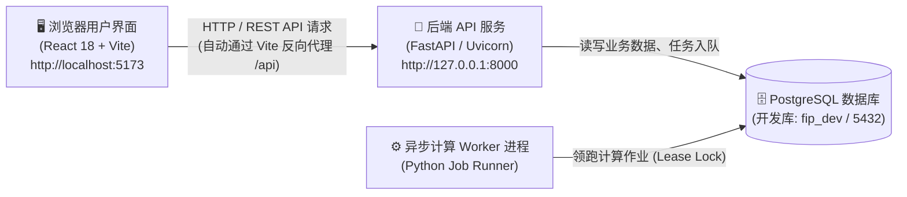

# Fund Investment Platform (基金投资平台) 本地启动与运行指南

本文档详细介绍了基金投资平台（Fund Investment Platform）的技术架构、本地启动步骤、各模块访问入口、环境变量配置及常见问题排查。

---

## 目录
- [一、服务架构与组成](#一服务架构与组成)
- [二、运行前置要求](#二运行前置要求)
- [三、方式一：一键极速启动（推荐）](#三方式一一键极速启动推荐)
- [四、方式二：手动分步启动（开发调试）](#四方式二手动分步启动开发调试)
- [五、系统主要访问入口与功能直达](#五系统主要访问入口与功能直达)
- [六、环境变量配置说明](#六环境变量配置说明)
- [七、常见问题排查 (FAQ)](#七常见问题排查-faq)

---

## 一、服务架构与组成

基金投资平台采用现代分离架构设计，各服务职责如下：



1. **前端 Web 界面**：基于 React 18、TypeScript、TanStack Query、ECharts 与 Vite 构建，监听端口 `5173`。开发服务器内置反向代理，自动将 `/api` 请求转发到后端。
2. **后端 API 服务**：基于 FastAPI 与 Uvicorn 构建，监听端口 `8000`，内置 OpenAPI 冻结契约投影、三态实盘看板、动态再平衡引擎及审计追踪中间件。
3. **后台 Worker 进程（可选）**：轮询 PostgreSQL 任务队列执行长时间复杂计算（如大样本重采样与多情景回测）。
4. **PostgreSQL 数据库（可选）**：存储基金历史行情、候选池版本、决策快照、实盘三态账本与调仓审计日志。

---

## 二、运行前置要求

在本地计算机运行本平台，需满足以下环境：

| 依赖项 | 推荐版本 | 用途说明 | 检查命令 |
| :--- | :--- | :--- | :--- |
| **Python** | 3.12.x | 运行后端 API、量化算法与领域模型 | `python3 --version` |
| **Node.js** | 18.x / 20.x+ | 运行前端 Web 开发服务器 | `node -v` |
| **npm** | 9.x+ / 10.x+ | 前端包依赖管理 | `npm -v` |
| **PostgreSQL** *(可选)* | 14.x / 16.x | 生产与持久化数据库（若仅试用前端与 Mock 数据非必需） | `psql --version` |

> [!NOTE]
> 项目原生支持**纯本地模式启动**，无需 Docker 或任何容器守护进程。

---

## 三、方式一：一键极速启动（推荐）

仓库根目录下提供了自动化启动脚本 [`start.sh`](file:///Users/zhukun/学习/fund-investment-platform/start.sh)，该脚本会自动完成依赖检测、启动后端、启动前端并进行就绪检查。

### 1. 执行一键启动
在项目根目录下打开终端运行：
```bash
./start.sh
```

### 2. 命令行选项说明
脚本支持按需传入参数：
```bash
# 同时启动后端 API、前端以及后台 Worker 进程
./start.sh --with-worker

# 仅启动后端 API 服务 (端口 8000)
./start.sh --api-only

# 仅启动前端 Web 开发服务 (端口 5173)
./start.sh --frontend-only

# 查看脚本帮助说明
./start.sh --help
```

### 3. 一键安全停止
在当前运行脚本的终端中按下键盘 **`Ctrl + C`**，脚本内建的进程陷阱（Trap Hook）将**自动且整洁地同步停止后端和前端所有子进程**，绝不会残留孤儿进程或占用端口。

---

## 四、方式二：手动分步启动（开发调试）

若需要单独对前端或后端进行独立调试，可按照以下步骤手动启动：

### 步骤 1：准备 Python 虚拟环境与依赖
在项目根目录运行：
```bash
# 1. 创建虚拟环境 (如尚未创建)
python3 -m venv .venv

# 2. 激活虚拟环境
source .venv/bin/activate

# 3. 安装依赖锁文件中的依赖包
pip install -r requirements.lock
```

### 步骤 2：启动 PostgreSQL 并执行数据库迁移（可选）
若本机已安装 PostgreSQL 并已创建数据库 `fip_dev`：
```bash
# 执行 Alembic 数据库版本迁移到最新状态
make migrate
```
*(若暂未启动 PostgreSQL，后端 API 仍可启动，部分无状态或 Mock 操作均可正常工作)*

### 步骤 3：启动后端 FastAPI 服务
在项目根目录运行：
```bash
# 启动 API 服务（开启热重载与 M2 实盘调仓路由）
PYTHONPATH=src FIP_ENABLE_M2_REBALANCE=true .venv/bin/uvicorn fip.api.app:app --host 127.0.0.1 --port 8000 --reload
```
或直接使用 Makefile 快捷指令：
```bash
make api-dev
```
启动成功后，控制台将输出 Uvicorn 监听日志，服务运行于 `http://127.0.0.1:8000`。

### 步骤 4：（可选）启动后台异步计算 Worker
若需要处理异步耗时优化作业，另开终端运行：
```bash
make worker-dev
# 或: PYTHONPATH=src .venv/bin/python -m fip.platform.jobs.worker
```

### 步骤 5：启动前端开发服务器
新开一个终端窗口，进入 `frontend` 目录：
```bash
cd frontend

# 安装前端 NPM 依赖（初次运行需执行）
npm install

# 启动 Vite 本地开发服务器
npm run dev
```
启动成功后，浏览器访问 `http://localhost:5173` 即可进入界面。

---

## 五、系统主要访问入口与功能直达

服务启动后，可在浏览器中打开对应 URL 体验全套功能：

### 1. Web 交互看板 (`http://localhost:5173`)
| 功能模块 | 访问路径 | 核心业务能力说明 |
| :--- | :--- | :--- |
| **基金筛选与全景研究** | [`/funds`](http://localhost:5173/funds) | 风格分类、多周期夏普/索提诺/信息比率穿透、全市场基金过滤与指标透视 |
| **基金深度详情** | [`/funds/000001`](http://localhost:5173/funds/000001) | 净值走势图表、时点归因、回撤分析、准入合规排查 |
| **候选池管理与快照** | [`/universes`](http://localhost:5173/universes) | 全时点（Point-in-Time）候选池入选规则筛选、成分变动历史留痕 |
| **组合决策详情页** | [`/portfolios/P001`](http://localhost:5173/portfolios/P001) | **集成三大核心子面板（通过顶部 Tab 切换）：**<br>① **组合优化与决策复核**：均值-方差优化、二次规划、PM 覆盖审批流；<br>② **实盘三态持仓监控（Stage ⑨）**：目标 vs 实际 vs 在途透视表、净值盯市漂移、在途防重复挂单加锁、本地模拟成交注入器；<br>③ **动态调仓与评估引擎（Stage ⑩）**：多触发器合并测算、换手率与交易成本把关、建议买卖指令清单。 |
| **组合策略回测** | [`/backtests`](http://localhost:5173/backtests) | 历史回测执行进度轮询、收益曲线对比、前瞻偏差与幸存者偏差五维排查 |

### 2. 后端开发者与监控入口 (`http://127.0.0.1:8000`)
| 入口说明 | 访问路径 | 功能说明 |
| :--- | :--- | :--- |
| **OpenAPI 交互式文档** | [`/docs`](http://127.0.0.1:8000/docs) | Swagger UI 在线接口调试，支持直接发送参数与查看契约响应 |
| **OpenAPI 契约架构** | [`/openapi.json`](http://127.0.0.1:8000/openapi.json) | 机器可读的 OpenAPI 3.1 规范定义 |
| **存活探针 (Liveness)** | [`/health/live`](http://127.0.0.1:8000/health/live) | 返回 `{"status":"ok"}`，用于判断 Web 进程运行状态 |
| **就绪探针 (Readiness)** | [`/health/ready`](http://127.0.0.1:8000/health/ready) | 检查数据库连接与数据版本迁移就绪状态 |
| **Prometheus 监控指标** | [`/metrics`](http://127.0.0.1:8000/metrics) | 标准 Prometheus 文本格式，输出 API QPS、延迟分布等统计 |

---

## 六、环境变量配置说明

项目支持通过在根目录下创建 `.env` 文件或直接在启动命令前配置环境变量：

| 环境变量名 | 默认值 | 作用说明 |
| :--- | :--- | :--- |
| `FIP_DATABASE_URL` | `postgresql+psycopg://localhost/fip_dev` | 主业务数据库连接字符串 |
| `FIP_ENABLE_M2_REBALANCE` | `false` | 是否开启 Stage ⑨ 实盘持仓与 Stage ⑩ 调仓 API 路由（`start.sh` 已默认开启） |
| `FIP_ENV` | `development` | 运行环境（`development` / `test` / `production`） |
| `FIP_RATE_LIMIT_PER_MINUTE` | `120` | API 令牌桶限流速率（每分钟最大请求次数） |
| `FIP_WORKER_POLL_SECONDS` | `1.0` | 异步计算 Worker 轮询任务队列的间隔秒数 |
| `VITE_API_BASE_URL` | *(空)* | 前端 API 目标基地址（留空时由 Vite 自动代理到本地 8000 端口） |

---

## 七、常见问题排查 (FAQ)

### Q1: 提示端口 8000 或 5173 已被占用？
**原因**：之前运行的服务未退出，或有其他程序占用了相同端口。  
**解决办法**：
- 查看占用进程：
  ```bash
  lsof -i :8000
  lsof -i :5173
  ```
- 杀死对应 PID：
  ```bash
  kill -9 <PID>
  ```
- 再次运行 `./start.sh`。

### Q2: 前端请求 API 出现网络错误或 404？
**排查步骤**：
1. 检查后端 API 是否已正常启动：
   ```bash
   curl http://127.0.0.1:8000/health/live
   ```
   若返回 `{"status":"ok"}`，说明后端服务正常。
2. Vite 配置文件 [`frontend/vite.config.ts`](file:///Users/zhukun/学习/fund-investment-platform/frontend/vite.config.ts) 已配置反向代理规则，会无缝把 `/api` 转发到 `http://127.0.0.1:8000`，请确保不要关闭后端服务。

### Q3: 运行 `make api-dev` 提示找不到 `uvicorn` 或 Python 模块？
**解决办法**：请确认是否使用了项目专属的虚拟环境 `.venv`：
```bash
source .venv/bin/activate
which uvicorn
```
或者直接使用仓库内置路径 `.venv/bin/uvicorn` 运行。

---

## 八、常用研发质量验证命令

为保证交付质量，日常开发中可随时执行以下全自动化检查：

```bash
# 运行后端所有单元测试与 API 测试 (400+ 项测试全覆盖)
.venv/bin/pytest tests/unit tests/api -q

# 运行 Python 静态类型严格检查
.venv/bin/mypy

# 运行 Python 代码风格规范检查
.venv/bin/ruff check src

# 运行前端全部 Vitest 测试套件 (112 项测试全覆盖)
cd frontend && npm test -- --run

# 运行前端代码格式与规范检查
cd frontend && npm run check
```
