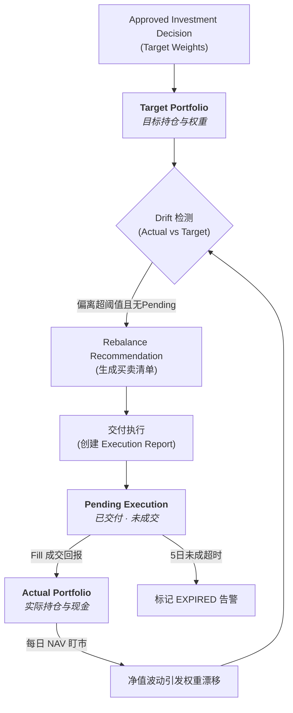

# Plan-8 Live Portfolio 与再平衡引擎设计规范

> 日期：2026-10-19  
> 状态：设计定案  
> 对应主链：Stage ⑨ Live Portfolio 与 Stage ⑩ Rebalancing  
> 上游：Stage ⑦ Portfolio Optimization（Approved Investment Decision）  
> 下游：外部模拟执行/实盘执行接口与调仓指令交付  

---

## 1. 目标与范围

本设计规范定义平台从“静态量化优化决策”向“动态实盘持仓管理与自动化再平衡”跨越的核心机制，完整落实系统架构第 12 章及领域文档 `docs/06-portfolio/06-rebalancing.md`：

1. **Stage ⑨ Live Portfolio（实盘持仓三态模型）**：
   - 维护 `Target Portfolio`（目标持仓）、`Pending Execution`（在途挂单）、`Actual Portfolio`（实际成交持仓）三个必须物理隔离的状态，坚决杜绝“以 Target 冒充 Actual”。
   - 外部成交回报（Execution Report / Fill）接收与状态流转（全额成交、部分成交、拒绝、超时过期 `EXPIRED`）。
   - 每日基于最新复权净值（NAV）逐日逐笔盯市（Mark-to-market），计算实际权重漂移（Weight Drift）。

2. **Stage ⑩ Rebalancing（再平衡与调仓引擎）**：
   - **四类触发器（Trigger Evaluator）**：
     - `Periodic`（周期到期，默认季度）→ 触发全链路重算（`FULL_PIPELINE`）。
     - `Drift`（个基或大类偏离超阈值）→ 触发从风险估计到优化的重算（`ESTIMATION_AND_OPT`）。
     - `Eligibility Event`（成分基金失去准入资格）→ 触发从候选池到优化的重算（`UNIVERSE_TO_OPT`）。
     - `Constraint Breach`（合规或风险预算超限）→ 触发重优化（`REOPTIMIZE_ONLY`）。
   - **多触发并发合并（Deepest Scope Merge）**：同时满足多个触发条件时，执行最深重算范围，但必须完整保留全部触发原因。
   - **防重复触发保护**：存在未超时的 `Pending Execution` 时，禁止产出新的调仓建议。
   - **调仓建议生成器（Rebalance Proposer）**：
     - 单边换手率（Turnover）计算：`0.5 * sum(|w_target - w_current|)`。
     - 非凸最小交易阈值（Minimum Trade Threshold）过滤，过滤后强制重新校验约束闭环。
     - 投资受限持仓处理（`HOLD_ONLY` 禁止加仓、`NOT_TRADABLE` 冻结持仓），显式报告未达成差额，杜绝静默分配。
     - 成本收益年化统一比较门槛（Cost-Benefit Gate）：预期年化改善须显著覆盖年化摊薄交易成本。
   - **全链路可解释性留痕（Explainability）**：无论“建议调仓”还是“放弃调仓”，必须输出结构化原因说明。

---

## 2. 核心架构与三态生命周期

### 2.1 三态隔离规则



1. **Target Portfolio**：由经过组合经理审批的 `InvestmentDecision` 生成，记录每个成分基金的目标分配比例与金额。
2. **Pending Execution**：调仓建议交付后生成的待执行委托。在收到成交回报前，`has_pending_execution = True`，阻止系统发起新的调仓。
3. **Actual Portfolio**：由外部成交回报（Fill）逐笔驱动更新的实际持仓（份额、成本、市值）及现金余额。

---

## 3. 再平衡触发与分级重算矩阵

| 触发类型 | 判定规则 | 重算范围（Recompute Scope） | 涵盖环节 |
|---|---|---|---|
| **Periodic** | 自上次调仓以来交易日达到调仓周期（如 63 交易日 / 1 季度） | `FULL_PIPELINE` | Factor → Score → Universe → Estimation → Optimization |
| **Drift** | 单只基金绝对偏离超过阈值（如 > 3%）或类别偏离超过阈值（如 > 5%） | `ESTIMATION_AND_OPT` | Risk/Return Estimation → Construction → Optimization（池与打分不变） |
| **Eligibility Event** | 现有持仓基金状态变为 `REJECTED` / `HOLD_ONLY` / `EXIT_ONLY` | `UNIVERSE_TO_OPT` | Fund Universe → Estimation → Construction → Optimization |
| **Constraint Breach** | 当前实际组合触碰权重上限或行业合规约束 | `REOPTIMIZE_ONLY` | Construction → Optimization（仅重新求解权重） |

### 3.1 深度序与并发合并规则
```text
REOPTIMIZE_ONLY (1) < ESTIMATION_AND_OPT (2) < UNIVERSE_TO_OPT (3) < FULL_PIPELINE (4)
```
当同一次检测中多个条件触发时，执行 `max(scopes)`，同时将所有触发原因合并存入 `trigger_reasons`。

---

## 4. 调仓清单生成算法与约束守则

1. **净目标差额**：
   $$\Delta w_i = w_{target, i} - w_{actual, i}$$
2. **单边换手率**：
   $$\text{Turnover} = 0.5 \sum_{i} |\Delta w_i|$$
3. **最小交易阈值（Min Trade Threshold）过滤**：
   若 $|\Delta w_i| < \tau_{\min}$，则令调整量为 0（不买不卖）。
   过滤后必须重新检验总权重和约束可行性；若导致硬约束违反，回退到原最优权重。
4. **可投资性受限拦截**：
   - `NOT_TRADABLE`：买卖均不可执行，权重保留为原状，不计入换手率。
   - `HOLD_ONLY` / `EXIT_ONLY`：若 $\Delta w_i > 0$（要求买入加仓），直接截断为 0，并将差额登记到 `unachieved_targets`，禁止自动将差额平摊到其他基金。
5. **成本收益统一判据（Cost-Benefit Gate）**：
   $$\text{Annualized Improvement} > \frac{\text{One-off Cost}}{\text{Holding Horizon}} \times \text{Multiplier} + \text{Min Threshold}$$
   若不满足，放弃调仓并记录原因：`SKIPPED_COST_BENEFIT`。

---

## 5. 数据库持久化模型（`portfolio` Schema）

新建 Alembic 迁移 `0033_live_portfolio_and_rebalancing.py`：
* `portfolio.live_portfolio`: 实盘组合主表（状态、现金、总权益、在途标志、上次调仓时间）。
* `portfolio.portfolio_position`: 持仓明细表（区分 `ACTUAL`、`TARGET`、`PENDING`，包含持仓份额、成本价、盯市价格、市值、权重、持有天数）。
* `portfolio.execution_report`: 外部成交回报记录（委托 ID、回报 ID、基金 ID、买卖方向、委托/成交份额、成交价、手续费、回报状态）。
* `portfolio.rebalance_event`: 再平衡评估与执行事件（触发类型集合、主触发类型、触发原因、重算范围、决策结果、换手率、预计成本、说明详情）。
* `portfolio.rebalance_trade`: 建议调仓明细买卖单（基金、买卖方向、当前权重、目标权重、权重变化、预估份额与金额、准入状态、是否被过滤、未达成原因）。
* `portfolio.rebalance_policy`: 再平衡策略参数版本（各项偏离阈值、最小交易门槛、换手率上限、成本收益比乘数、超时天数）。

---

## 6. API 端点规划（M2 契约扩展）

* `GET /api/v1/portfolios/{id}/live`: 获取实盘三态持仓概况与最新净值权重。
* `POST /api/v1/portfolios/{id}/execution-reports`: 外部模拟或实盘交易系统推送成交回报。
* `POST /api/v1/portfolios/{id}/rebalances/evaluate`: 触发实盘组合再平衡判定与重算。
* `GET /api/v1/portfolios/{id}/rebalances`: 查询历史调仓事件列表与解释。
* `GET /api/v1/rebalances/{rebalance_id}/trades`: 获取具体再平衡事件生成的交易买卖清单。
